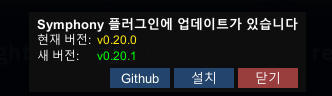

[한국어](README.ko.md) | [English](README.md)

# Symphony
`Symphony` is a [BepInEx](https://github.com/BepInEx/BepInEx) plugin for the PC client of `LastOrigin`, operated by `VALOFE`.
It provides a collection of quality-of-life (QoL) features for players.

## Installation
1. Download the **BepInEx-Unity.Mono-win-x64** version of [BepInEx](https://github.com/BepInEx/BepInEx) 6 from the [download page](https://github.com/BepInEx/BepInEx/releases/tag/v6.0.0-pre.2).
2. Extract the archive into the installation folder that contains `LastOrigin.exe`.\
   Make sure `winhttp.dll` and `LastOrigin.exe` are in the same folder.
3. Download `Symphony.dll` from the [Releases page](https://github.com/WolfgangKurz/Symphony/releases) and place it in `BepInEx/plugins`.

## How to Use
Press `F1` in game to open or close the plugin settings.

The following is a description of each feature within the plugin.

### QuickConfig
Quickly changes commonly used in-game settings.

- Adjusts BGM, sound effect, and voice volume, as well as background playback.
- Controls silhouette mode and lobby speech bubbles.

### GracefulFPS
A collection of FPS-related features for the game.

- Displays the current FPS and provides separate global and battle FPS limits.\
  The global limit supports `Vanilla`, `Fixed`, and `VSync`; the battle limit can also inherit the global setting.

### SimpleTweaks
A collection of simple quality-of-life improvements for the game.

- Assigns a hotkey for hiding the lobby UI.
- Prevents the game window's aspect ratio from being locked and its position from resetting after a resize, and allows the fullscreen toggle key to be reassigned.
- Remembers the last Offline Battle options.
- Changes background audio behavior from pausing to muting when background playback is enabled.
- Allows the Story Viewer skip key to be reassigned.
- Provides a faster logo screen, earlier title-screen interaction, and automatic login.
- Prevents BGM from restarting after audio device changes.

The default key for toggling fullscreen/windowed mode is `F11`.

### SimpleUI
Modifies parts of the UI to make them easier to use.

- Adds World Menu buttons for quickly returning to the last visited Battle Map or Offline Battle Map.
- Opens the map instead of the Offline Battle status screen when an Offline Battle is in progress.
- Adds enemy previews to battle information.
- Can hide character resource costs by default and open character details by double-clicking a list entry.
- Can shrink entries in character, equipment, temporary inventory, and consumable lists to show more items at once.
- Supports instant search with `Enter` in selected character and equipment search fields.
- Adds consumable sorting, exclusive-equipment-first display, and additional character sorting options.
- Adds Previous/Next and Favorite controls to character details, and allows stat points to be removed without a full reset.
- Adds character/equipment crafting previews and Select All controls to disassembly screens.
- `Scrapbook Must Be Fancy` adds skin backgrounds and additional display controls to the Scrapbook.
- `Exchange: No Messy Hand` hides sold-out products, shows relevant consumables, and supports repeat purchases.
- `Better Facility List` sorts facilities by name and level and displays the level of owned facilities.
- `Give Me Back LivingStation Navigation` restores navigation buttons at the top of the Base screen.
- Can display normal or final vote-benefit effects for selected characters in the Scrapbook.
- Adds a control for clearing squad members in one action. The leader of the normal master squad is retained.
- Accelerates scrolling and panning and can invert zoom direction.
- Fixes Story Viewer text display issues and makes long consumable descriptions scrollable.

### Notification
Forwards supported in-game push notifications to Windows notifications.

- Exploration, character repair, and Offline Battle notifications respect their in-game settings; research-completion notifications are also scheduled.

### Presets
A collection of crafting preset features.

- Adds resource presets for Character crafting.
- Automatically restores the last values used for Character, Equipment, and Facility Part crafting.

### Automation
> ### Warning!
> This section contains **automation (macro)** features.\
> Their use may lead to restrictions by the game operator, so use them with caution.

- `Character Share` lets you export the current character or squad configuration—including stats, skill-use priorities, equipment, and full-link bonuses—as a share code, or import one. Importing automatically applies some settings, and squad sharing may cause problems.
  - Short codes upload the configuration data to `symphony-sharetext.swaytwig.com`. Select `원본 복사` (Copy Raw Data) to use the feature without uploading it.
  - Anyone with a short code can retrieve its uploaded configuration, so share it only with the intended recipients.
- Restarts Base facilities after using the built-in Collect All function.
- Adds a Restart function for completed Offline Battles. (Disassembly settings are taken from the last Offline Battle run on PC.)

### Experimental
A collection of experimental features.

These features are not fully validated. Disable the affected option if you encounter problems.

- Fixes several battle freezes caused by particles, movement animations, or specific skins.
- Provides Fast Loading by skipping unnecessary assets during startup.
  - Assets required for the game to run are still loaded at startup.
  - Other assets skipped during startup are loaded when the game first references them, which may briefly cause the game to stutter.
- `Better Texture Filter` improves mipmaps and filtering so textures look clearer in smaller game windows.
  - Select either `Built-in` or `Lanczos + Sharpen` filtering and the `RGBA32`, `BC3/DXT5`, or `BC7` texture format.
  - Spine models always use `Built-in` filtering and the `RGBA32` format.
  - `RGBA32` is lossless but uses more memory and cache space; `BC7` offers better quality than `BC3` but takes longer to process.
  - Processing a texture for the first time may briefly stutter the game. Generated caches are stored in `BetterTextureFilter/Caches` under the game folder.

### KeyMapping
Simulates touches or clicks with keyboard input.

- Assign keys to screen positions and configure multiple key-map groups and overlay opacity.

### Statistics
Records and displays changes to in-game resources and items.

- Records resource changes and can optionally include item changes.
- Stores records in SQLite databases under the game folder's `Statistics` directory.
- Database filenames include the game account WID, so take care when sharing them.
- The record viewer requires internet access to jsDelivr and cdnjs to load its required libraries.
- Opens the bundled record viewer or the records folder directly from the settings screen.

### AssetLoader
A custom loader that reads AssetBundles from the game folder's `AssetLoader` directory and is always active.
It attempts to convert and load bundles built for non-Windows targets, but some bundles may remain incompatible.
Converted bundles are cached beside their source files with a `.patched` suffix.

## Updates
If the plugin requires an update, the following message will be displayed when the game starts.

At startup, the plugin contacts the GitHub Releases API to check for updates and release notes.

Clicking the `[설치]` (Install) button downloads and installs the latest plugin version, then restarts the game after installation.

Clicking the `[Github]` button opens this repository's Releases page.

## Disclaimer
This is an unofficial mod. By using this mod, you agree that you are solely responsible for any issues or damages that may arise. Always back up your important data before use. The developer assumes no liability for any loss or damage caused by the use of this mod.

## License
The `Symphony` project is under the `LGPL-2.1 license`.

### Exceptions
The following exceptions apply.

`VALOFE`, the developer/operator of the game `LastOrigin` (including its subsidiaries and affiliates), is not required to fulfill all or part of the obligations normally required under `LGPL-2.1`—such as `source code disclosure`, `permitting relinking or linking to alternative versions`, and `allowing reverse engineering`—when using, modifying, or distributing this library and source code **within the scope directly related to the development and operation of `LastOrigin`**.

This additional permission is **limited to VALOFE** and may not be transferred or assigned to any third party.

This additional permission applies **only to code owned by the copyright holder (project owner)** and does not affect components or external dependencies that include third-party copyrights.

These exceptions do not restrict the rights of other users; all third parties other than VALOFE remain subject to the base license (`LGPL-2.1`).
